  

## Olá, eu sou a Layse 👋

Estudo **Sistemas de Informação no CIn/UFPE** e desenvolvo **software para negócios e saúde digital**, com foco em sistemas confiáveis e em agentes de inteligência artificial.

Gosto de entender a rotina de quem vai usar o sistema antes de escrever código. Já atuei como **Product Owner** e hoje trabalho como desenvolvedora em um produto que está em produção, atendendo cliente real.

### O que construo

- **Gestão empresarial:** estoque, vendas, caixa e fiscal, com permissões por loja e organização.
- **Confiabilidade:** testes de ponta a ponta, monitoramento, alertas e envio de e-mails resiliente.
- **IA aplicada:** agentes conversacionais, ferramentas MCP e visão computacional com deep learning.
- **Saúde digital:** levantamento de requisitos e validação de sistemas de informação em saúde.

### Tecnologias que uso

| Área | Tecnologias |
|---|---|
| Linguagens | TypeScript · Python · JavaScript · C · C++ |
| Interfaces | React · Vite · Tailwind CSS · HTML/CSS |
| APIs e dados | NestJS · Prisma · PostgreSQL |
| IA e dados | LLMs · Agentes · MCP · PyTorch · Pandas · NumPy · OpenCV |
| Qualidade e entrega | Jest · Playwright · Testcontainers · Docker · GitHub Actions |
| Produto | Scrum · Product Owner · Requisitos · Jira · Notion |

### Onde contribuo

**Clarumi · gestão empresarial com agentes de IA** 
Plataforma de gestão para o varejo que reúne compras, estoque, vendas, financeiro e fiscal, com agentes que atendem pelo WhatsApp. O sistema já está em produção.

- **Segurança:** permissões por loja e organização, sessão e auditorias de segurança.
- **Confiabilidade:** monitoramento do banco, alerta de backup e envio de e-mail resiliente.
- **Produto:** contagem de estoque, inventário e melhorias em vendas e fiscal.
- **Qualidade:** testes E2E com Playwright e testes de integração com PostgreSQL real.

`TypeScript` `NestJS` `Prisma` `PostgreSQL` `React` `Vite` `Jest` `Playwright` `GitHub Actions`

### Projetos em destaque

**[Tudo em Dia ↗](https://tudo-em-dia.vercel.app)** 
Gerenciador de tarefas para estudos e projetos que eu criei do zero. Tem quadro Kanban, prazos, subtarefas e visões de "Hoje" e "Atrasadas". Funciona offline como app instalável (PWA) e sincroniza entre celular e computador quando a pessoa cria uma conta.

`JavaScript` `Tailwind CSS` `Supabase` `Service Worker` `Vercel`

**[BPA · Boletim de Produção Ambulatorial ↗](https://github.com/jaikarla/projeto-ds)** 
Sistema desenvolvido em equipe para a Clínica de Especialidades Odontológicas do Hospital Odontológico da UFPE. Fiquei com o banco de dados no Neon, a configuração segura de ambiente, os testes das regras de negócio de procedimentos e os registros de decisão de arquitetura (ADRs).

`React` `Node.js` `Express` `PostgreSQL` `Vitest`

**Psiu · rede de apoio para mães atípicas** 
Protótipo mobile-first de uma plataforma de acolhimento para mães solo de crianças neurodivergentes. Tem mural anônimo de desabafo, chat entre mães, rotina visual das terapias com botão de crise e painel de alertas para psicólogos parceiros.

`TypeScript` `React` `Tailwind CSS`

**[Íris ↗](https://github.com/mclaudiarocha/vibehack-girls)** 
Plataforma criada no hackathon Vibehack Grrrl. Transforma relatos anônimos em indicadores de segurança para mulheres no ambiente de trabalho, usando inteligência artificial.

`TypeScript` `IA`

Também fiz: **Road Pavement Classification**, classificação de pavimentos com deep learning · pipeline de dados sobre dengue com dados do SINAN/OpenDataSUS · **SpaCINvadors**, jogo 2D em Python.

### Como penso os projetos

Um sistema bom é aquele em que dá para confiar: permissões claras, erros com nome e testes que provam o que foi entregue. Busco tecnologia que simplifique a rotina e chegue a quem precisa dela.

### Certificações

- **Anthropic:** Claude Code in Action e Claude 101 (2026)
- **Hashtag Treinamentos:** Imersão Agentes IA, com agentes autônomos e LLMs
- **Jornada Python:** automação e bibliotecas de integração

---

  Vamos conversar? <a href="mailto:lmfg@cin.ufpe.br">lmfg@cin.ufpe.br</a> · <a href="https://github.com/laysemgomes/meu-portfolio-git">Portfólio</a> 
  Recife, PE · aberta a estágios e projetos em produto, saúde digital e IA

